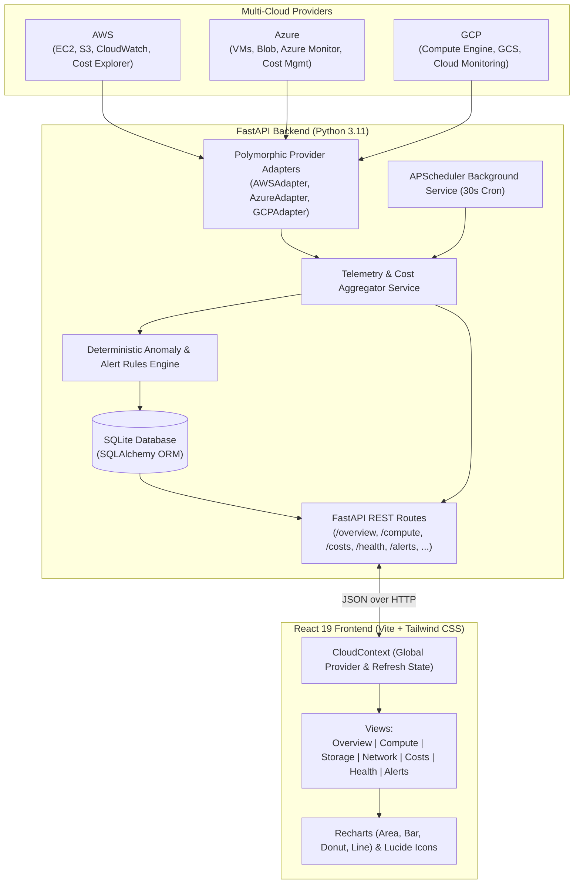
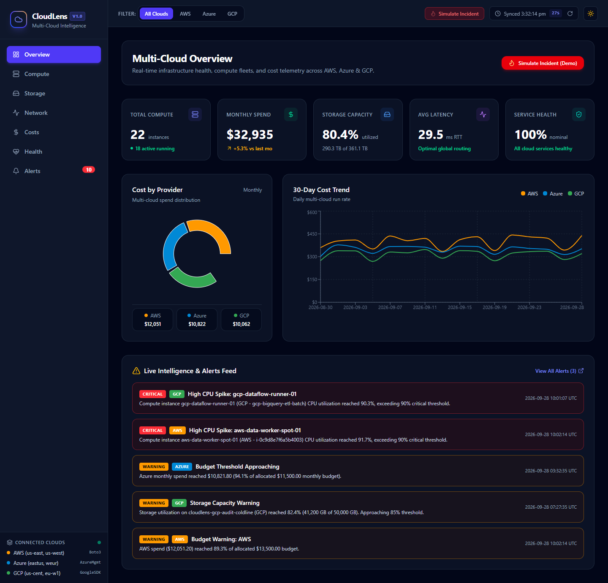
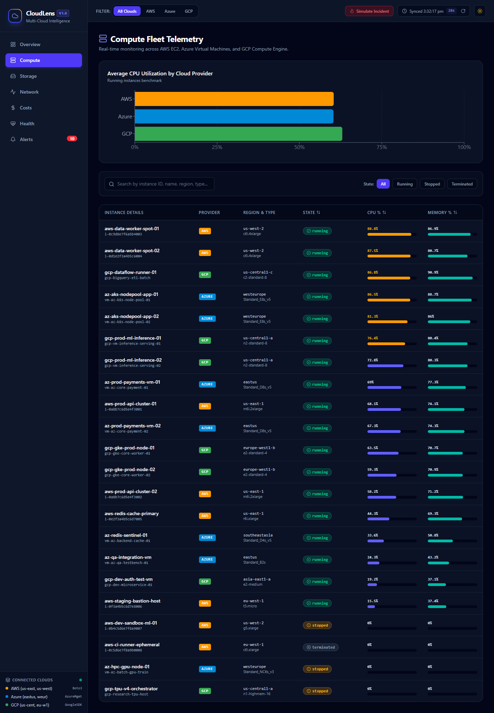
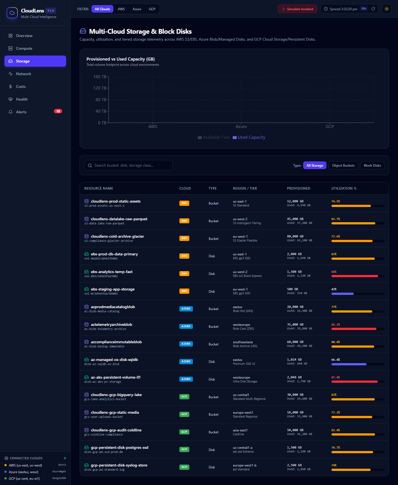
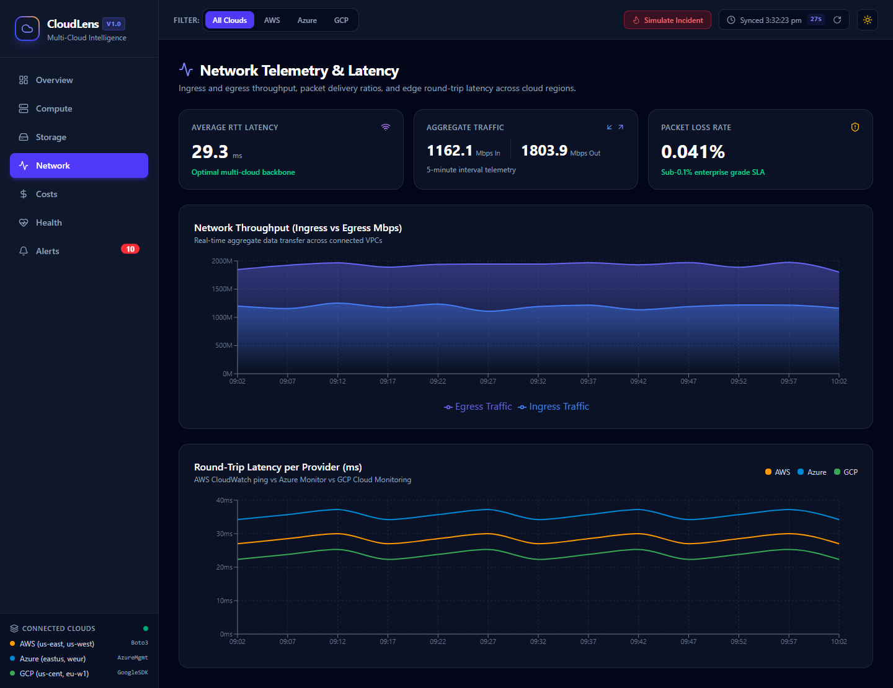
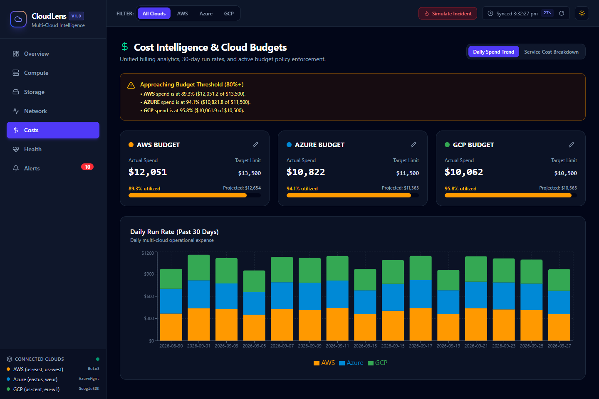
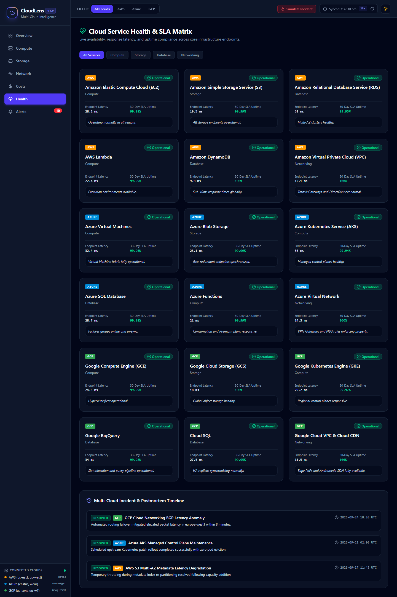
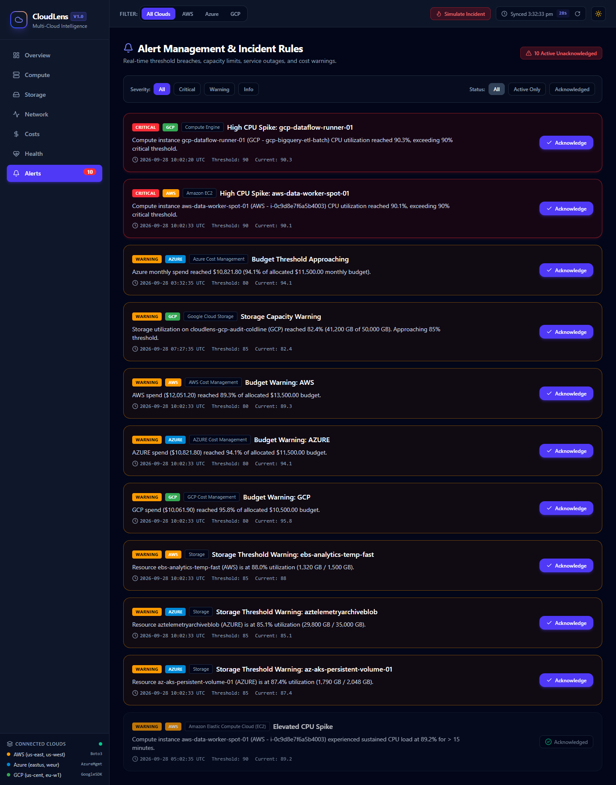
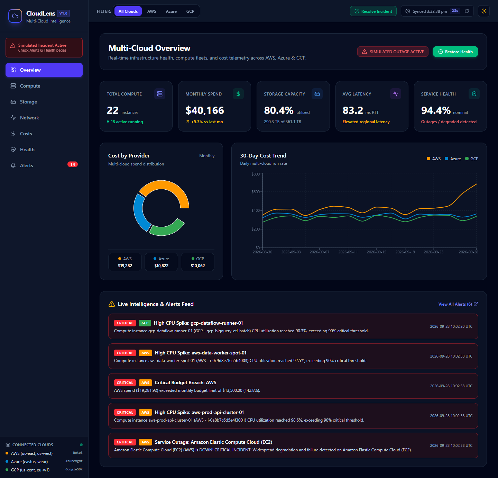

# ☁️ CloudLens: Unified Multi-Cloud Monitoring & Cost Intelligence Platform

[](https://www.python.org/)
[](https://fastapi.tiangolo.com/)
[](https://react.dev/)
[](https://vitejs.dev/)
[](https://tailwindcss.com/)
[](https://www.docker.com/)
[](https://opensource.org/licenses/MIT)

> **A single pane of glass for real-time telemetry, resource inventory, cross-cloud FinOps cost governance, and automated incident response across AWS, Microsoft Azure, and Google Cloud Platform (GCP).**

---

## 📌 Executive Summary

Modern enterprise architectures span heterogeneous cloud environments to mitigate vendor lock-in, satisfy regional compliance, and optimize workload performance. However, SREs, DevOps engineers, and FinOps analysts frequently face fragmented operational silos—navigating disparate cloud consoles, inconsistent metric naming, incompatible billing cadences, and segregated alerting rules.

**CloudLens** eliminates cross-cloud friction by aggregating multi-cloud telemetry, cost analytics, and infrastructure health into a unified, lightning-fast dashboard. It standardizes telemetry formats across providers, evaluates real-time anomaly detection rules, orchestrates budget governance, and includes an interactive Chaos Engineering Incident Simulator for operational disaster drill validation.

---

## 🌟 Key Features

- **🌐 Unified Cross-Cloud Single Pane of Glass**:
  - Ingests compute, storage, network, and cost telemetry simultaneously from **Amazon Web Services (AWS)**, **Microsoft Azure**, and **Google Cloud Platform (GCP)**.
  - Global provider toggle (All / AWS / Azure / GCP) allowing instant workspace filtering.

- **📊 Comprehensive Telemetry & Analytics Modules**:
  - **Executive Overview**: High-level cluster KPIs (total instances, vCPU count, memory footprint, storage used, active alerts, monthly run-rate) alongside interactive resource distribution donuts and 30-day spend trends.
  - **Compute Telemetry**: Multi-cloud instance inventory (EC2, Azure VMs, Compute Engine) featuring real-time CPU/memory meters, state badges, region indicators, and multi-field search and sorting.
  - **Storage Intelligence**: Storage pool capacity tracking (AWS S3, Azure Blob, GCS) with provisioned vs. utilized capacity stacked visualizations and per-bucket usage meters.
  - **Network Telemetry**: Ingress vs. Egress throughput bandwidth area charts, round-trip latency tracking, and packet-loss risk indicators across geographical regions.

- **💰 FinOps Cost Governance & Dynamic Budgeting**:
  - Granular multi-cloud daily and monthly spend aggregation.
  - Service-by-service cost distribution breakdown (Compute, Storage, Networking, Managed Services).
  - Runtime-editable monthly budget targets per provider with live threshold enforcement ($>80\%$ warning, $>100\%$ critical).

- **🚨 Deterministic Alert & Anomaly Engine**:
  - Continuous rules engine evaluating high CPU saturation ($>90\%$), storage capacity exhaustion ($>85\%$), network latency spikes ($>120\text{ ms}$), service outages, and budget breaches.
  - Interactive alert triaging with acknowledged/resolved state management.

- **🔥 Chaos Engineering & Incident Simulator**:
  - One-click synthetic incident injector simulating critical compute failure (e.g. AWS EC2 failure, latency spike, critical alert generation).
  - Validate real-time frontend alert propagation, system status degradation, and automated resolution workflows.

- **⏱️ Automated Background Polling**:
  - Asynchronous background telemetry collection executed every 30 seconds via APScheduler with SQLite historical persistence.

---

## 🏗️ Architecture & Data Flow



---

## 📸 Screenshots Gallery

| 1. Unified Executive Overview | 2. Compute Workload Inventory |
|:---:|:---:|
|  |  |

| 3. Storage Capacity Intelligence | 4. Network Telemetry & Latency |
|:---:|:---:|
|  |  |

| 5. FinOps Cost Analytics & Budgets | 6. Multi-Cloud Health Status |
|:---:|:---:|
|  |  |

| 7. Centralized Alert Manager | 8. Chaos Incident Triggered |
|:---:|:---:|
|  |  |

---

## 🛠️ Technology Stack

| Layer | Technologies |
|---|---|
| **Frontend Framework** | React 19, Vite 5, JavaScript (ES2024) |
| **Styling & Icons** | Tailwind CSS 3, Lucide React Icons |
| **Data Visualization** | Recharts (Responsive Line, Bar, Area, and Pie/Donut charts) |
| **Backend API** | FastAPI 0.110+, Uvicorn, Python 3.11+ |
| **Data Persistence** | SQLAlchemy 2.0, SQLite |
| **Background Tasks** | APScheduler (30-second automated metrics collection) |
| **Testing** | Pytest, Pytest-Asyncio, HTTPX |
| **Containerization** | Docker, Docker Compose, Nginx |

---

## 🚀 Quick Start Guide

### Option 1: Native Local Launch (Fastest)

#### On Windows:
Double-click `run.bat` or run:
```bat
run.bat
```

#### On Linux / macOS:
```bash
chmod +x run.sh
./run.sh
```

The script will launch:
- **Backend API**: `http://localhost:8000` (Interactive Docs: `http://localhost:8000/docs`)
- **Frontend Dashboard**: `http://localhost:5173`

---

### Option 2: Docker Compose (Production Ready)

Run the entire multi-container stack with a single command:
```bash
docker compose up --build
```

- **Frontend App**: `http://localhost:3000`
- **Backend API**: `http://localhost:8000`
- **Interactive Swagger Docs**: `http://localhost:8000/docs`

---

### Option 3: Cloud Deployment (Vercel Frontend + Render Backend)

#### 1. Backend Deployment on Render
1. Go to [Render Dashboard](https://dashboard.render.com/) and click **New +** > **Blueprint** (or **Web Service**).
2. Select repository: `https://github.com/Teja-1007/cloudlens`.
3. Render detects [`render.yaml`](./render.yaml) automatically:
   - **Root Directory**: `backend`
   - **Build Command**: `pip install -r requirements.txt`
   - **Start Command**: `uvicorn app.main:app --host 0.0.0.0 --port $PORT`
   - **Health Check**: `/api/ping`
4. Click **Apply / Deploy**. Once deployed, copy your backend URL (e.g. `https://cloudlens-backend.onrender.com`).

#### 2. Frontend Deployment on Vercel
1. Go to [Vercel Dashboard](https://vercel.com/new) and import `https://github.com/Teja-1007/cloudlens`.
2. Configure Project:
   - **Framework Preset**: `Vite`
   - **Root Directory**: `frontend`
   - **Build Command**: `npm run build`
   - **Output Directory**: `dist`
3. In **Environment Variables**, add:
   - `VITE_API_URL` = `https://<your-render-backend-name>.onrender.com`
4. Click **Deploy**. Vercel will build and assign your production domain.

---

### Option 4: Manual Step-by-Step Setup

#### 1. Backend Setup
```bash
cd backend
python -m venv venv

# Windows:
venv\Scripts\activate
# Linux/macOS:
source venv/bin/activate

pip install -r requirements.txt
python -m uvicorn app.main:app --host 127.0.0.1 --port 8000 --reload
```

#### 2. Frontend Setup
```bash
cd frontend
npm install
npm run dev
```

---

## 📡 REST API Reference

| Method | Endpoint | Description |
|---|---|---|
| `GET` | `/api/ping` | Health check endpoint for container probes |
| `GET` | `/api/overview?provider={all\|aws\|azure\|gcp}` | Aggregated multi-cloud KPI metrics and 30-day spend summary |
| `GET` | `/api/compute?provider={...}&status={...}&search={...}` | List all instances with CPU/memory usage and state filters |
| `GET` | `/api/storage?provider={...}` | Storage bucket list, total provisioned vs. used capacity |
| `GET` | `/api/network?provider={...}` | Network ingress/egress bandwidth history and latency metrics |
| `GET` | `/api/costs?provider={...}&granularity={daily\|monthly}` | Historical cost breakdown and per-service spend distribution |
| `GET` | `/api/health?provider={...}` | Provider regional health states and recent incident logs |
| `GET` | `/api/alerts?status={active\|acknowledged\|resolved}` | Real-time threshold alerts across all providers |
| `POST` | `/api/alerts/{alert_id}/acknowledge` | Acknowledge an active alert |
| `GET` | `/api/budget` | Current provider budget targets and percentage utilization |
| `PUT` | `/api/budget/{provider}` | Update monthly budget limit for a cloud provider |
| `POST` | `/api/simulate-incident` | Trigger chaos incident simulation (CPU spike, down state) |
| `POST` | `/api/resolve-incident` | Clear simulated incident and restore baseline telemetry |

---

## 🔌 Pluggable Cloud Provider Adapters

CloudLens is engineered with an extensible **Adapter Pattern** defined in `backend/app/adapters/base.py`:

```python
class CloudProviderAdapter(ABC):
    @abstractmethod
    async def get_compute_metrics(self) -> List[ComputeInstance]: ...
    
    @abstractmethod
    async def get_storage_metrics(self) -> List[StorageBucket]: ...
    
    @abstractmethod
    async def get_network_metrics(self) -> NetworkTelemetry: ...
    
    @abstractmethod
    async def get_cost_data(self) -> CostBreakdown: ...
    
    @abstractmethod
    async def get_health_status(self) -> ProviderHealth: ...
```

### Swapping Mock Data with Real Cloud SDKs
Each provider adapter (`aws.py`, `azure.py`, `gcp.py`) contains clean hook points documented for live SDK drop-in:

- **AWS Adapter** (`app/adapters/aws.py`):
  Replace mock queries with `boto3.client('ec2')`, `boto3.client('s3')`, `boto3.client('cloudwatch')`, and `boto3.client('ce')` (Cost Explorer).
- **Azure Adapter** (`app/adapters/azure.py`):
  Integrate `azure-mgmt-compute`, `azure-mgmt-storage`, `azure-mgmt-monitor`, and `azure-mgmt-consumption`.
- **GCP Adapter** (`app/adapters/gcp.py`):
  Integrate `google-cloud-compute`, `google-cloud-storage`, `google-cloud-monitoring`, and `google-cloud-billing`.

---

## 🧪 Automated Testing

CloudLens includes comprehensive automated test coverage validating adapters, aggregators, alert rules, and API endpoints.

To run the test suite:
```bash
cd backend
python -m pytest tests/ -v
```

Test modules:
- `test_adapters.py`: Validates schema conformance and provider telemetry generation.
- `test_aggregator.py`: Verifies multi-cloud metric aggregation, filtering, and summaries.
- `test_alert_rules.py`: Tests threshold evaluation logic for CPU, storage, and budget bounds.
- `test_endpoints.py`: Tests all FastAPI endpoints with synthetic client requests.

---

## 📁 Repository Directory Structure

```text
CLOUDLENS/
├── backend/
│   ├── app/
│   │   ├── adapters/          # AWS, Azure, GCP polymorphic telemetry adapters
│   │   │   ├── base.py
│   │   │   ├── aws.py
│   │   │   ├── azure.py
│   │   │   └── gcp.py
│   │   ├── models/            # Pydantic schemas & SQLAlchemy DB models
│   │   │   ├── db_models.py
│   │   │   └── schemas.py
│   │   ├── routes/            # FastAPI route controllers
│   │   │   ├── overview.py
│   │   │   ├── compute.py
│   │   │   ├── storage.py
│   │   │   ├── network.py
│   │   │   ├── costs.py
│   │   │   ├── health.py
│   │   │   ├── alerts.py
│   │   │   ├── budget.py
│   │   │   └── incident.py
│   │   ├── services/          # Aggregation, Alert engine, APScheduler
│   │   │   ├── aggregator.py
│   │   │   ├── alert_engine.py
│   │   │   └── scheduler.py
│   │   ├── database.py        # SQLite engine & session management
│   │   └── main.py            # FastAPI entry point & lifespan events
│   ├── tests/                 # Pytest test suite
│   ├── Dockerfile             # Production backend container definition
│   └── requirements.txt       # Python dependencies
├── frontend/
│   ├── src/
│   │   ├── components/        # Sidebar, Topbar, Layout components
│   │   ├── context/           # CloudContext (Provider filter & refresh state)
│   │   ├── pages/             # Overview, Compute, Storage, Network, Costs, Health, Alerts
│   │   ├── api.js             # Centralized Axios/Fetch client
│   │   ├── App.jsx            # Router and top-level provider binding
│   │   └── main.jsx
│   ├── public/                # Static assets & SVG icons
│   ├── Dockerfile             # Multi-stage production Nginx container
│   ├── nginx.conf             # Nginx reverse proxy configuration
│   └── package.json           # Frontend dependencies & scripts
├── docs/
│   ├── screenshots/           # Application screenshots for all 7 modules
│   └── PROJECT_REPORT.md      # Detailed academic and architectural report
├── docker-compose.yml         # Full-stack orchestrator
├── run.bat                    # One-click Windows dev runner
├── run.sh                     # One-click Unix/Linux/macOS dev runner
└── README.md                  # Project documentation & reference
```

---

## 📄 License

This project is licensed under the [MIT License](LICENSE).
