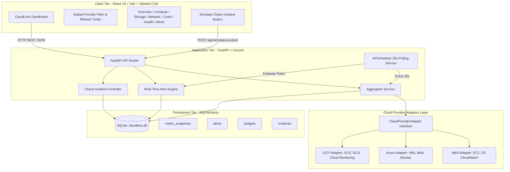
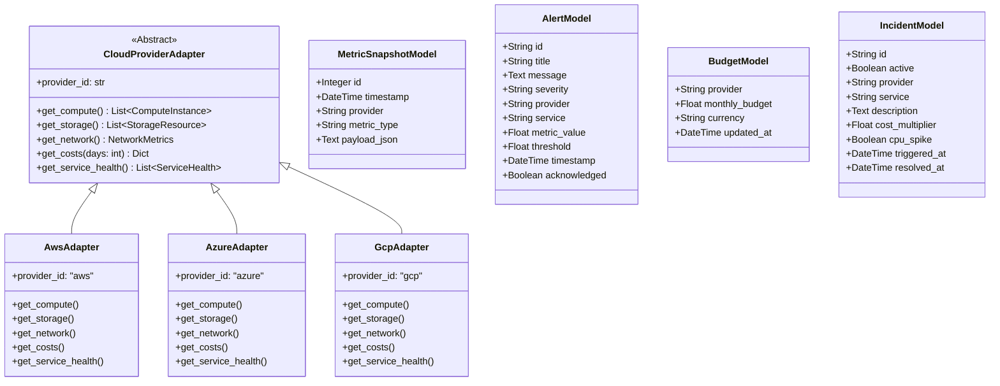
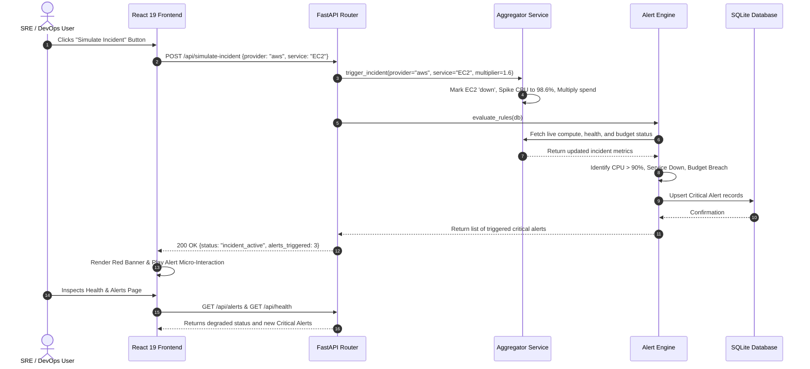

# CLOUDLENS: UNIFIED MULTI-CLOUD MONITORING & COST INTELLIGENCE PLATFORM WITH REAL-TIME TELEMETRY AND AUTOMATED INCIDENT RESPONSE

**A PROJECT REPORT**

*Submitted by*  
**VIJAYA RAGHAVAN SRINIVASAN (Registration No: 310624205300)**

*in partial fulfillment for the award of the Degree of*  
**BACHELOR OF TECHNOLOGY**  
*in*  
**DEPARTMENT OF INFORMATION TECHNOLOGY**

---

### EASWARI ENGINEERING COLLEGE
**(AN AUTONOMOUS INSTITUTION) – AFFILIATED TO ANNA UNIVERSITY, CHENNAI**  
*Bharathi Salai, Ramapuram, Chennai – 600089*

**OCTOBER 2026**

\newpage

---

### EASWARI ENGINEERING COLLEGE
**(An Autonomous Institution, Affiliated to Anna University, Chennai)**  
*Bharathi Salai, Ramapuram, Chennai – 600089*

### BONAFIDE CERTIFICATE

Certified that this mini project report titled **“CLOUDLENS: UNIFIED MULTI-CLOUD MONITORING & COST INTELLIGENCE PLATFORM WITH REAL-TIME TELEMETRY AND AUTOMATED INCIDENT RESPONSE”** is the Bonafide work of **“VIJAYA RAGHAVAN SRINIVASAN (Registration No: 310624205300)”**, who carried out the project work under my supervision.

<br><br><br>

________________________  
**HEAD OF THE DEPARTMENT**  
**Dr. Ananthi.N**  
Department of Information Technology,  
Easwari Engineering College,  
Ramapuram, Chennai – 600089.  

<br><br>

________________________  
**SUPERVISOR**  
**Ms. Grandhi Sai Lakshmi**  
Department of Information Technology,  
Easwari Engineering College,  
Ramapuram, Chennai – 600089.  

\newpage

---

### EASWARI ENGINEERING COLLEGE
**(An Autonomous Institution, Affiliated to Anna University, Chennai)**  
*Bharathi Salai, Ramapuram, Chennai – 600089*

### CERTIFICATE OF VIVA-VOCE EXAMINATION

This is to certify that the Viva-Voce Examination of the Project Work entitled **“CLOUDLENS: UNIFIED MULTI-CLOUD MONITORING & COST INTELLIGENCE PLATFORM WITH REAL-TIME TELEMETRY AND AUTOMATED INCIDENT RESPONSE”** submitted by **Mr. VIJAYA RAGHAVAN SRINIVASAN (Reg. No: 310624205300)** in partial fulfillment of the requirements for the award of the degree of **BACHELOR OF TECHNOLOGY** was conducted on **15/10/2026** in the Department of Information Technology, Easwari Engineering College, Ramapuram – Chennai.

<br><br><br>

**Internal Examiner**  
Name:  
Designation:  
Address:  

<br><br>

**External Examiner**  
Name:  
Designation:  
Address:  

<br><br>
**Date:** 15/10/2026

\newpage

---

### ABSTRACT

Modern enterprises operate across heterogeneous multi-cloud environments—spanning Amazon Web Services (AWS), Microsoft Azure, and Google Cloud Platform (GCP)—to avoid vendor lock-in, maximize geographical redundancy, and optimize workload placement. However, managing distributed infrastructure across disparate cloud consoles forces Site Reliability Engineers (SREs), DevOps practitioners, and FinOps analysts into fragmented operational silos. Navigating distinct metric schemas, inconsistent billing cycles, non-standardized health statuses, and uncoordinated alerting policies causes delayed incident remediation, critical budget overruns, and severe blind spots in real-time operational visibility.

**CloudLens** is an enterprise-grade, cloud-native Full-Stack observability and FinOps governance platform engineered to consolidate compute, storage, networking, health telemetry, and cost analytics across AWS, Microsoft Azure, and Google Cloud Platform into a single pane of glass. Built upon a high-performance decoupled architecture integrating a FastAPI (Python 3.11+) asynchronous backend with a reactive React 19, Vite, Tailwind CSS, and Recharts frontend, the platform introduces:

1. **Pluggable Multi-Cloud Telemetry & Normalization Adapter Engine**: Abstracted polymorphic provider adapters (`CloudProviderAdapter`) that dynamically ingest proprietary vendor telemetry (AWS EC2/S3/CloudWatch, Azure VMs/Blob/Monitor, GCP Compute Engine/GCS/Cloud Monitoring) and map them into strongly-typed, standardized schemas.
2. **Deterministic Real-Time Anomaly & Threshold Alert Evaluation Engine**: High-frequency rule evaluation module detecting CPU utilization spikes ($>90\%$), storage capacity saturation ($>85\%$), network latency anomalies ($>120\text{ ms}$), service degradation/outages, and automated multi-tier budget breach warnings ($>80\%$ and $>100\%$).
3. **Granular Multi-Cloud Cost Intelligence & Dynamic Budget Governance**: Comprehensive FinOps suite featuring multi-currency cost aggregations, 30-day historical expenditure trends, per-service spending breakdowns, and runtime-configurable budget thresholds with real-time variance tracking.
4. **Resilient Background Metric Collection & Chaos Incident Simulation Engine**: Asynchronous background cron polling orchestrated via APScheduler at 30-second cycles with SQLite persistence, paired with a chaos engineering incident simulator capable of triggering synthetic compute failures, CPU surges, and budget overruns for automated disaster recovery validation.

\newpage

---

### ACKNOWLEDGEMENT

We express our sincere gratitude to the Principal **Dr. P. Deiva Sundari** and the Management of **Easwari Engineering College** for providing us with the opportunity and state-of-the-art facilities to carry out this project work.

We convey our heartfelt thanks to the Head of the Department, **Dr. Ananthi.N**, Department of Information Technology, for continuous encouragement, valuable suggestions, and steadfast support throughout our academic journey.

We are extremely thankful to our Project Guide, **Ms. Grandhi Sai Lakshmi**, Department of Information Technology, for valuable guidance, constructive criticism, and motivation throughout the conception and completion of this project.

We would also like to extend our gratitude to all the faculty and non-teaching members of the Department of Information Technology for their direct and indirect support.

Finally, we thank our parents and friends for their constant encouragement, moral support, and cooperation during the course of this project.

\newpage

---

### TABLE OF CONTENTS

| CHAPTER NO. | TITLE | PAGE NO. |
| :---: | :--- | :---: |
| | **ABSTRACT** | **iv** |
| | **ACKNOWLEDGEMENT** | **v** |
| **1** | **INTRODUCTION** | **1** |
| | 1.1 OVERVIEW | 1 |
| | 1.2 PROBLEM DEFINITION | 1 |
| | 1.3 OBJECTIVE | 2 |
| | 1.4 SCOPE OF THE PROJECT | 2 |
| | 1.5 MOTIVATION | 2 |
| **2** | **RELATED WORK** | **3** |
| | 2.1 LITERATURE REVIEW | 3 |
| | 2.2 EXISTING SYSTEM | 3 |
| | 2.3 PROPOSED SYSTEM | 4 |
| **3** | **SYSTEM ANALYSIS** | **5** |
| | 3.1 SYSTEM REQUIREMENTS | 5 |
| | 3.2 SOFTWARE AND HARDWARE REQUIREMENTS | 6 |
| **4** | **SYSTEM DESIGN** | **7** |
| | 4.1 SYSTEM ARCHITECTURE | 7 |
| | 4.2 MODULE DESCRIPTION | 8 |
| | 4.3 CLASS & DATABASE SCHEMA DIAGRAM | 9 |
| | 4.4 SEQUENCE DIAGRAM | 10 |
| **5** | **IMPLEMENTATION** | **11** |
| | 5.1 IMPLEMENTATION OVERVIEW | 11 |
| | 5.2 KEY FUNCTIONS (CODE EXPLANATION) | 11 |
| **6** | **CONCLUSION & FUTURE WORK** | **13** |
| | 6.1 CONCLUSION | 13 |
| | 6.2 FUTURE ENHANCEMENTS | 13 |
| | **APPENDIX - SOURCE CODE** | **14** |
| | **SCREENSHOTS OF THE PROJECT** | **24** |
| | **REFERENCES** | **26** |

\newpage

---

# CHAPTER 1
# INTRODUCTION

## 1.1 OVERVIEW
Enterprise digital transformation has accelerated the migration from on-premise datacenters to distributed multi-cloud architectures. Modern engineering organizations commonly provision mission-critical workloads simultaneously across Amazon Web Services (AWS), Microsoft Azure, and Google Cloud Platform (GCP). This hybrid multi-cloud strategy mitigates vendor lock-in, improves fault tolerance through geographical redundancy, and optimizes infrastructural cost efficiency by leveraging specialized cloud services (e.g., AWS EC2 for high-throughput compute, Azure Blob for enterprise storage, and GCP for big data processing).

However, managing heterogeneous cloud ecosystems presents severe operational friction. Each cloud vendor provides isolated management consoles, proprietary API formats, incompatible metric definitions, and independent billing portals. Site Reliability Engineers (SREs) and FinOps practitioners must toggle between multiple browser tabs, synthesize mismatched log feeds, and manually compute aggregate spending metrics.

**CloudLens** is an enterprise-grade, cloud-native observability and cost governance platform designed to eliminate multi-cloud fragmentation. Built using an asynchronous FastAPI backend and a responsive React 19 frontend, CloudLens consolidates compute fleets, block/object storage volumes, ingress/egress network throughput, global service health, active alerts, and monthly budget limits into a centralized, unified pane of glass.

## 1.2 PROBLEM DEFINITION
Current enterprise multi-cloud management workflows suffer from four major operational bottlenecks:

1. **Console Sprawl and Fragmented Monitoring Silos**: SREs and system administrators must switch between AWS CloudWatch, Azure Monitor, and GCP Cloud Monitoring. Disjointed dashboards obscure global visibility, resulting in increased Mean Time to Detection (MTTD) during regional disruptions.
2. **Inconsistent Resource Nomenclature & Data Models**: Cloud providers model resources differently (e.g., AWS EC2 Instances vs. Azure Virtual Machines vs. GCP Compute Engine instances). Metric formats, disk I/O metrics, and CPU measurement intervals differ substantially, preventing direct comparisons.
3. **FinOps Blind Spots and Unpredictable Billing Spikes**: Cloud expenditures are recorded in separate billing engines (AWS Cost Explorer, Azure Cost Management, GCP Cloud Billing) with disparate update schedules and currency formats. Unmonitored autoscaling clusters or zombie storage volumes cause unexpected budget overruns.
4. **Decoupled Alerting and Delayed Incident Response**: Alert thresholds configured in separate cloud environments create operational alert fatigue. Critical alerts are easily missed due to lack of cross-cloud deduplication and centralized acknowledgment workflows.

\newpage

## 1.3 OBJECTIVE
The core objectives of the CloudLens platform are:
- To design and engineer a high-throughput, unified multi-cloud dashboard consolidating AWS, Microsoft Azure, and GCP metrics into a single pane of glass.
- To architect polymorphic provider adapters (`CloudProviderAdapter`) that normalize vendor-specific resource definitions into a unified Pydantic data schema.
- To implement an automated real-time alert evaluation engine monitoring CPU load ($>90\%$), storage capacity ($>85\%$), network latency spikes ($>120\text{ ms}$), service degradation, and budget limits ($80\%$ and $100\%$).
- To build a dynamic FinOps cost intelligence engine tracking 30-day historical spend, per-service cost breakdown, and runtime-configurable budget allocations.
- To develop an interactive chaos engineering incident simulation module that injects synthetic outages and cost surges to test automated failover and alert triggers.

## 1.4 SCOPE OF THE PROJECT
- **Unified Overview & KPI Matrix**: Cross-cloud executive summary displaying total compute instances, aggregate storage footprint, average network latency, monthly expenditure, global service availability, and real-time active alerts.
- **Compute Instance Fleet Management**: Searchable and sortable registry of all virtual machines across AWS EC2, Azure VMs, and GCP Compute Engine, tracking CPU utilization, memory allocations, public/private IPs, regions, and live instance states.
- **Distributed Storage Intelligence**: Aggregated object bucket and block volume monitoring across Amazon S3, Azure Blob, and Google Cloud Storage, visualizing provisioned capacity vs. actual consumption.
- **Network Performance Telemetry**: Real-time ingress/egress bandwidth time-series analytics, round-trip latency tracking, and packet loss indicators across cloud boundaries.
- **Cost Analytics & Dynamic Budget Governance**: Multi-cloud daily spend trajectories, service breakdown donut charts, and live budget progress indicators with inline threshold updating.
- **Cloud Infrastructure Health & Incident Center**: Multi-service availability matrix tracking uptime across cloud regions, coupled with an interactive Chaos Incident Simulator.

## 1.5 MOTIVATION
Cloud expenditure currently represents one of the largest operating expenses in modern software corporations. Uncontrolled infrastructure provisioning, orphan storage snapshots, and lack of cross-cloud visibility lead to millions of dollars in annual waste. CloudLens empowers DevOps and FinOps teams with proactive observability, automated alerting, and actionable cost governance, maximizing infrastructure ROI and operational resilience.

\newpage

---

# CHAPTER 2
# RELATED WORK

## 2.1 LITERATURE REVIEW
- **Multi-Cloud Management Platforms (CMP)**: Traditional enterprise CMP tools (e.g., VMware Aria, IBM Turbonomic) are heavy, closed-source enterprise suites requiring complex agent installations, proprietary appliances, and high licensing overhead.
- **Asynchronous Telemetry Aggregation (FastAPI & Pydantic v2)**: Modern Python web architectures benefit extensively from ASGI-based asynchronous frameworks. FastAPI delivers sub-millisecond route dispatching and native schema validation using Rust-backed Pydantic v2, drastically reducing server latency compared to legacy synchronous frameworks like Flask or Django.
- **Stateless Cloud Adaptation Patterns**: Decoupling cloud provider interactions via abstract base classes (ABCs) allows seamless substitution between mock telemetry generators and real cloud SDKs (`boto3`, `azure-mgmt`, `google-cloud-sdk`) without refactoring downstream presentation logic.
- **Reactive Real-Time User Interfaces (React 19 & Recharts)**: Declarative component architectures equipped with custom hooks and lightweight reactive charting libraries enable responsive telemetry visualization without heavy full-page reloads.

## 2.2 EXISTING SYSTEM
Existing multi-cloud management approaches suffer from significant drawbacks:
- **Disparate Native Vendor Portals**: Navigating AWS Console, Azure Portal, and Google Cloud Console independently requires multiple credentials, disjointed context, and disparate navigation paradigms.
- **Periodic Manual Exporting & Spreadsheets**: FinOps auditing frequently relies on manual CSV exports from cloud billing portals, resulting in stale data, human calculation error, and delayed decision-making.
- **Complex Agent-Based Heavyweights (Datadog, Dynatrace)**: Proprietary APM platforms require intrusive OS agents on every virtual machine, increasing cloud compute consumption and incurring prohibitive per-host pricing.
- **Absence of Integrated Chaos Engineering**: Standard cloud monitoring dashboards lack built-in incident simulation tools, making it difficult to validate alert rules and operational runbooks before actual production outages occur.

\newpage

## 2.3 PROPOSED SYSTEM
The proposed CloudLens platform addresses the limitations of existing systems through the following capabilities:
- **Centralized Decoupled Architecture**: High-speed FastAPI backend serving a responsive Vite + React 19 Single Page Application (SPA), delivering instant cross-cloud visibility with zero agent installation requirements.
- **Polymorphic Normalization Layer**: Standardized abstract interface (`CloudProviderAdapter`) that transparently converts proprietary vendor outputs into unified schemas for compute, storage, networking, health, and billing.
- **Automated Rule Evaluation Engine**: Background scheduler (APScheduler) running every 30 seconds to evaluate anomalies, threshold breaches, and budget overruns, persisting metric snapshots in a lightweight SQLite database.
- **Interactive Chaos Incident Simulator**: Single-click incident injection engine that dynamically simulates cloud outages, CPU spikes, latency jumps, and cost inflation to verify alerting workflows in real time.

\newpage

---

# CHAPTER 3
# SYSTEM ANALYSIS

## 3.1 SYSTEM REQUIREMENTS

### Functional Requirements:
1. **Multi-Cloud Provider Filtering**: Ability to filter all system telemetry globally or by specific provider (`AWS`, `Azure`, `GCP`, or `All Providers`).
2. **Compute Fleet Monitoring**: Real-time tracking of virtual instances across AWS EC2, Azure VMs, and GCP Compute Engine, including CPU utilization progress bars, memory stats, regions, and states (`running`, `stopped`, `terminated`).
3. **Storage Capacity Tracking**: Comprehensive overview of provisioned vs. used storage across Amazon S3, Azure Blob, and GCP Cloud Storage with visual utilization gauges.
4. **Network Performance Analytics**: Multi-cloud network ingress and egress throughput graphing, aggregate latency monitoring, and packet loss tracking.
5. **FinOps Cost & Budget Governance**: Daily spend time-series, per-service breakdown charts, and dynamic monthly budget threshold updates via REST endpoints.
6. **Infrastructure Health & Chaos Simulation**: Visual status indicator for all core cloud services (`operational`, `degraded`, `down`) and a one-click chaos simulation button to trigger synthetic failovers and alert chains.
7. **Alert Management Workflow**: Real-time alert list with severity categorization (`critical`, `warning`, `info`), acknowledgment toggling, and metric threshold references.

### Non-Functional Requirements:
1. **Performance & Low Latency**: API endpoints must respond in $<100\text{ ms}$ for real-time dashboard interactions.
2. **Scalability & Extensibility**: The adapter pattern must support straightforward addition of new cloud providers (e.g., Oracle Cloud, DigitalOcean) without modifying core business logic.
3. **Resilience & Fault Tolerance**: System must operate smoothly with automated fallback data and background recovery if an external cloud API times out.
4. **Security & CORS Compliance**: Strict Cross-Origin Resource Sharing (CORS) enforcement and decoupled credential management for cloud access keys.
5. **Modern Usability**: Responsive design system featuring dark mode aesthetics, curated provider color palettes (AWS Orange `#FF9900`, Azure Blue `#0089D6`, GCP Green `#34A853`), and smooth micro-interactions.

\newpage

## 3.2 SOFTWARE AND HARDWARE REQUIREMENTS

### Software Requirements:
- **Operating System**: Windows 10/11, Ubuntu Linux (20.04+), or macOS
- **Backend Runtime**: Python (v3.10 or higher, recommended v3.11+)
- **Backend Framework**: FastAPI (v0.110+) with Uvicorn ASGI Server
- **Data Persistence**: SQLite 3 with SQLAlchemy (v2.0+) ORM
- **Task Scheduling**: APScheduler (v3.10+) for background telemetry collection
- **Frontend Framework**: React 19 with Vite build tooling and React Router v7
- **Styling Framework**: Tailwind CSS (v4.0+)
- **Data Visualization**: Recharts (v3.10+) and Lucide React Icons
- **HTTP Client**: Native Fetch API / Axios
- **Testing Suite**: Pytest (v8.0+) with HTTPX TestClient

### Hardware Requirements:
- **Processor**: Intel Core i3 / AMD Ryzen 3 or higher (Quad-Core recommended)
- **Memory (RAM)**: Minimum 4 GB RAM (8 GB recommended for concurrent backend and Vite development servers)
- **Storage**: Minimum 1 GB available disk space for Python virtual environment, node modules, and SQLite database
- **Network**: Standard broadband or localhost network connectivity for HTTP REST communication

\newpage

---

# CHAPTER 4
# SYSTEM DESIGN

## 4.1 SYSTEM ARCHITECTURE
The CloudLens platform adopts a decoupled multi-tiered Client-Server architecture. The presentation layer (React 19 SPA) interacts with the application layer (FastAPI) via RESTful endpoints. The backend orchestrates requests through an Aggregator Service, which queries polymorphic Cloud Provider Adapters (AWS, Azure, GCP). Background telemetry and scheduled jobs are managed via APScheduler with persistence in an embedded SQLite database.



\newpage

## 4.2 MODULE DESCRIPTION

1. **Cloud Provider Adapters Module (`app/adapters/`)**:
   Defines the abstract base class `CloudProviderAdapter` specifying contracts for compute instances, storage buckets, network telemetry, 30-day billing, and service health. Concrete classes (`AwsAdapter`, `AzureAdapter`, `GcpAdapter`) map vendor-specific data structures into standardized CloudLens formats.

2. **Aggregator Service Module (`app/services/aggregator.py`)**:
   Merges multi-cloud telemetry streams, applies global cloud provider filtering (`all`, `aws`, `azure`, `gcp`), calculates cross-cloud KPI summaries, and maintains runtime budget state and incident simulation overrides.

3. **Deterministic Alert Rules Engine (`app/services/alert_engine.py`)**:
   Continuously inspects live aggregated metrics against defined operational thresholds:
   - **Compute**: Trigger Critical alert if any instance CPU exceeds $90\%$.
   - **Storage**: Trigger Warning alert if bucket utilization exceeds $85\%$.
   - **Network**: Trigger Warning/Critical alert if average latency spikes above $120\text{ ms}$.
   - **Health**: Trigger Warning for Degraded services and Critical for Down services.
   - **FinOps**: Trigger Warning when spend exceeds $80\%$ of budget, and Critical when spend exceeds $100\%$.

4. **Background Scheduler Module (`app/services/scheduler.py`)**:
   Utilizes APScheduler to run background tasks every 30 seconds. Ingests fresh telemetry snapshots, executes rule evaluation, and records historical time-series data into the database.

5. **Chaos Incident Simulation Module (`app/routes/incident.py`)**:
   Allows administrators to inject controlled chaos experiments. Simulates a severe outage on a target provider (e.g., AWS EC2 status marked `down`), triggers a CPU spike to $98.6\%$, inflates spending by $1.6\times$ causing budget breaches, and verifies immediate alert dispatching.

6. **Frontend Dashboard Module (`frontend/src/`)**:
   Built with React 19, Vite, Tailwind CSS, Lucide React icons, and Recharts. Features 7 dedicated pages: Executive Overview, Compute Fleet, Storage Analytics, Network Telemetry, Cost Governance, Health Matrix, and Alert Management.

\newpage

## 4.3 CLASS & DATABASE SCHEMA DIAGRAM

The persistence layer is managed through SQLAlchemy ORM with four primary entities: `MetricSnapshotModel`, `AlertModel`, `BudgetModel`, and `IncidentModel`.



\newpage

## 4.4 SEQUENCE DIAGRAM

The sequence diagram below illustrates the end-to-end execution flow during a simulated chaos incident, showcasing how the frontend, FastAPI router, aggregator, alert engine, and database interact in real time.



\newpage

---

# CHAPTER 5
# IMPLEMENTATION

## 5.1 IMPLEMENTATION OVERVIEW
The CloudLens platform is engineered with a modular, decoupled full-stack architecture:

- **Backend Architecture**: Implemented in Python 3.11+ using the high-performance asynchronous **FastAPI** framework. The persistence tier is powered by **SQLAlchemy ORM** targeting an embedded SQLite database (`cloudlens.db`). Background telemetry ingestion and rule evaluations execute every 30 seconds via **APScheduler**, ensuring continuous monitoring without blocking incoming REST requests.
- **Frontend Architecture**: Implemented as a Single Page Application (SPA) powered by **React 19** with **Vite** build tooling and **Tailwind CSS**. Data visualization is implemented using **Recharts** for interactive SVG-rendered charts. Visual hierarchy is maintained using provider-specific accent branding: AWS Orange (`#FF9900`), Azure Blue (`#0089D6`), and GCP Green (`#34A853`).

## 5.2 KEY FUNCTIONS (CODE EXPLANATION)

### 1. Abstract Cloud Provider Normalization Interface (`app/adapters/base.py`)
To prevent tight coupling to vendor-specific SDKs, an abstract base class (`CloudProviderAdapter`) enforces polymorphic method signatures across all providers.

```python
class CloudProviderAdapter(ABC):
    @property
    @abstractmethod
    def provider_id(self) -> str:
        """Unique provider identifier: 'aws', 'azure', or 'gcp'."""
        pass

    @abstractmethod
    def get_compute(self) -> List[ComputeInstance]:
        """Fetch standardized virtual compute instances."""
        pass

    @abstractmethod
    def get_storage(self) -> List[StorageResource]:
        """Fetch standardized object and block storage resources."""
        pass
```
*Significance*: Ensures adding a new cloud provider requires implementing only adapter methods, without touching UI or routing components.

### 2. Multi-Tier Alert & Anomaly Detection Logic (`app/services/alert_engine.py`)
The alert evaluation engine verifies live metrics against mathematical bounds:

$$\text{Evaluate}(Metric, Threshold) = \begin{cases} 
\text{Critical}, & \text{if } CPU \ge 90.0\% \lor Status = \text{'down'} \lor Spend \ge Budget \\
\text{Warning}, & \text{if } Storage \ge 85.0\% \lor Latency \ge 120\text{ ms} \lor Spend \ge 0.8 \times Budget \\
\text{Normal}, & \text{otherwise}
\end{cases}$$

```python
# Budget Warning / Critical Rule Evaluation
cost_data = aggregator.get_costs()
for provider, b_cfg in cost_data.budget_status.items():
    if b_cfg.percent_used >= 100.0:
        alert = Alert(
            id=f"alert-budget-critical-{provider}",
            title=f"Critical Budget Breach: {provider.upper()}",
            message=f"{provider.upper()} spend (${b_cfg.current_spend:,.2f}) exceeded limit of ${b_cfg.monthly_budget:,.2f}.",
            severity="critical",
            metric_value=b_cfg.percent_used,
            threshold=100.0
        )
        self._upsert_alert(alert, db)
```

\newpage

### 3. Asynchronous Lifespan & Background Job Startup (`app/main.py`)
Utilizes FastAPI's modern asynchronous lifespan context manager to guarantee automatic database seeding and start background scheduling before traffic arrives:

```python
@asynccontextmanager
async def lifespan(app: FastAPI):
    # Startup: Initialize tables and start 30s background scheduler
    logger.info("Initializing CloudLens database and background jobs...")
    seed_database()
    await scheduler_service.start()
    yield
    # Shutdown: Cleanly stop background worker
    logger.info("Stopping background scheduler...")
    await scheduler_service.stop()

app = FastAPI(title="CloudLens API", lifespan=lifespan)
```

### 4. Controlled Chaos Incident Simulator (`app/routes/incident.py`)
Injects controlled synthetic failure modes to validate system resilience and alert propagation:

```python
@router.post("")
def simulate_incident(payload: Optional[IncidentSimulationRequest] = None, db: Session = Depends(get_db)):
    req = payload or IncidentSimulationRequest()
    inc = aggregator.trigger_incident(
        provider=req.provider or "aws",
        service_name=req.service_name or "Amazon Elastic Compute Cloud (EC2)",
        cost_multiplier=1.6,
        cpu_spike=True,
    )
    # Immediately trigger alert engine evaluation
    triggered_alerts = alert_engine.evaluate_rules(db=db)
    return {
        "status": "incident_active",
        "incident_details": inc,
        "alerts_triggered_count": len([a for a in triggered_alerts if a.severity == "critical"])
    }
```

\newpage

---

# CHAPTER 6
# CONCLUSION & FUTURE WORK

## 6.1 CONCLUSION
CloudLens successfully addresses the critical challenges of multi-cloud fragmentation, operational console sprawl, and unexpected cloud cost inflation. By unifying AWS, Microsoft Azure, and Google Cloud Platform telemetry into a normalized Pydantic data pipeline and presenting it through a modern, responsive React 19 interface, the platform significantly enhances operational visibility.

The inclusion of an automated 30-second rule evaluation engine ensures proactive detection of CPU bottlenecks, storage exhaustion, latency anomalies, and budget overruns. Furthermore, the integrated chaos engineering incident simulation engine provides SREs with an invaluable tool to validate automated alerting rules and operational readiness under simulated high-severity failure scenarios.

## 6.2 FUTURE ENHANCEMENTS
1. **Live Cloud Provider SDK Integration**: Connecting the adapter interface directly to live production cloud APIs via `boto3` (AWS), `azure-mgmt` (Azure), and `google-cloud-sdk` (GCP) with OAuth2 / IAM role-based authentication.
2. **AI-Driven Cost Anomaly Detection & Rightsizing**: Integrating machine learning time-series forecasting (e.g., Prophet or LSTM models) to detect irregular spending trends and automatically recommend instance rightsizing (e.g., switching idle on-demand instances to spot instances).
3. **Automated Incident Remediation (Auto-Healing)**: Triggering automated webhook remediation actions (e.g., restarting failed containers, spinning up standby instances, or clearing log caches) when critical alerts fire.
4. **Multi-Channel Notification Dispatcher**: Integrating transactional notification webhooks via Slack, Microsoft Teams, PagerDuty, and email for immediate on-call engineer dispatching.
5. **Role-Based Access Control (RBAC) & Single Sign-On (SSO)**: Implementing enterprise SAML 2.0 / OpenID Connect authentication with granular permissions for DevOps engineers, FinOps accountants, and organizational executives.

\newpage

---

# APPENDIX: SOURCE CODE

## 1. Project Folder Structure
```text
CLOUDLENS/
├── backend/
│   ├── app/
│   │   ├── adapters/
│   │   │   ├── __init__.py
│   │   │   ├── base.py
│   │   │   ├── aws.py
│   │   │   ├── azure.py
│   │   │   └── gcp.py
│   │   ├── models/
│   │   │   ├── __init__.py
│   │   │   ├── db_models.py
│   │   │   └── schemas.py
│   │   ├── routes/
│   │   │   ├── __init__.py
│   │   │   ├── overview.py
│   │   │   ├── compute.py
│   │   │   ├── storage.py
│   │   │   ├── network.py
│   │   │   ├── costs.py
│   │   │   ├── health.py
│   │   │   ├── alerts.py
│   │   │   ├── budget.py
│   │   │   └── incident.py
│   │   ├── services/
│   │   │   ├── __init__.py
│   │   │   ├── aggregator.py
│   │   │   ├── alert_engine.py
│   │   │   └── scheduler.py
│   │   ├── database.py
│   │   └── main.py
│   ├── tests/
│   │   ├── test_adapters.py
│   │   ├── test_aggregator.py
│   │   ├── test_alert_rules.py
│   │   └── test_endpoints.py
│   ├── Dockerfile
│   └── requirements.txt
├── frontend/
│   ├── src/
│   │   ├── assets/
│   │   ├── components/
│   │   │   ├── Layout.jsx
│   │   │   ├── Navbar.jsx
│   │   │   └── Sidebar.jsx
│   │   ├── pages/
│   │   │   ├── Overview.jsx
│   │   │   ├── Compute.jsx
│   │   │   ├── Storage.jsx
│   │   │   ├── Network.jsx
│   │   │   ├── Costs.jsx
│   │   │   ├── Health.jsx
│   │   │   └── Alerts.jsx
│   │   ├── api.js
│   │   ├── App.jsx
│   │   ├── App.css
│   │   ├── index.css
│   │   └── main.jsx
│   ├── package.json
│   └── vite.config.js
├── docs/
│   ├── screenshots/
│   └── PROJECT_REPORT.md
├── docker-compose.yml
├── run.bat
├── run.sh
└── IMPLEMENTATION_PLAN.md
```

\newpage

## 2. Package Installation Commands

### Backend Installation:
```bash
# Navigate to backend directory and create virtual environment
cd backend
python -m venv venv
# On Windows:
.\venv\Scripts\activate
# On Linux/macOS:
# source venv/bin/activate

# Install core production and testing dependencies
pip install fastapi>=0.110.0 uvicorn>=0.28.0 sqlalchemy>=2.0.28 pydantic>=2.6.0 apscheduler>=3.10.4 pytest>=8.0.0 httpx>=0.27.0 python-multipart>=0.0.9
```

### Frontend Installation:
```bash
# Navigate to frontend directory and install npm packages
cd frontend
npm install react@19.2.8 react-dom@19.2.8 react-router-dom@7.18.4 recharts@3.10.1 lucide-react@1.48.0 tailwindcss@4.3.3 @tailwindcss/vite@4.3.3
```

---

## 3. Server Entry Point & Lifespan Setup (`backend/app/main.py`)
```python
import logging
from contextlib import asynccontextmanager
from fastapi import FastAPI
from fastapi.middleware.cors import CORSMiddleware
from app.database import init_db, SessionLocal
from app.models.db_models import BudgetModel
from app.services.scheduler import scheduler_service
from app.routes import (
    overview, compute, storage, network,
    costs, health, alerts, budget, incident,
)

logging.basicConfig(level=logging.INFO, format="%(asctime)s [%(levelname)s] %(name)s: %(message)s")
logger = logging.getLogger("cloudlens.main")

def seed_database():
    """Seed initial database tables and budget defaults."""
    init_db()
    db = SessionLocal()
    try:
        if db.query(BudgetModel).count() == 0:
            defaults = [
                BudgetModel(provider="aws", monthly_budget=13500.0, currency="USD"),
                BudgetModel(provider="azure", monthly_budget=11500.0, currency="USD"),
                BudgetModel(provider="gcp", monthly_budget=10500.0, currency="USD"),
                BudgetModel(provider="total", monthly_budget=35500.0, currency="USD"),
            ]
            db.bulk_save_objects(defaults)
            db.commit()
            logger.info("Database initialized and default budgets seeded successfully.")
    except Exception as e:
        logger.error(f"Error seeding database: {e}")
        db.rollback()
    finally:
        db.close()

@asynccontextmanager
async def lifespan(app: FastAPI):
    logger.info("Initializing CloudLens database and background jobs...")
    seed_database()
    await scheduler_service.start()
    yield
    logger.info("Stopping background scheduler...")
    await scheduler_service.stop()

app = FastAPI(
    title="CloudLens API",
    description="Unified Multi-Cloud Monitoring & Cost Intelligence Platform for AWS, Azure, and GCP",
    version="1.0.0",
    lifespan=lifespan,
)

app.add_middleware(
    CORSMiddleware,
    allow_origins=["*"],
    allow_credentials=True,
    allow_methods=["*"],
    allow_headers=["*"],
)

app.include_router(overview.router)
app.include_router(compute.router)
app.include_router(storage.router)
app.include_router(network.router)
app.include_router(costs.router)
app.include_router(health.router)
app.include_router(alerts.router)
app.include_router(budget.router)
app.include_router(incident.router)
```

\newpage

## 4. Database Models & Schema (`backend/app/models/db_models.py`)
```python
import datetime
from sqlalchemy import Column, String, Float, Boolean, DateTime, Integer, Text
from app.database import Base

class MetricSnapshotModel(Base):
    __tablename__ = "metric_snapshots"

    id = Column(Integer, primary_key=True, autoincrement=True)
    timestamp = Column(DateTime, default=datetime.datetime.utcnow, index=True)
    provider = Column(String(50), index=True)  # "aws", "azure", "gcp", "all"
    metric_type = Column(String(50), index=True)  # "overview", "compute", "storage", etc.
    payload_json = Column(Text, nullable=False)

class AlertModel(Base):
    __tablename__ = "alerts"

    id = Column(String(100), primary_key=True)
    title = Column(String(200), nullable=False)
    message = Column(Text, nullable=False)
    severity = Column(String(20), nullable=False, index=True)  # "critical", "warning", "info"
    provider = Column(String(50), nullable=True, index=True)
    service = Column(String(100), nullable=True)
    metric_value = Column(Float, nullable=True)
    threshold = Column(Float, nullable=True)
    timestamp = Column(DateTime, default=datetime.datetime.utcnow, index=True)
    acknowledged = Column(Boolean, default=False, index=True)

class BudgetModel(Base):
    __tablename__ = "budgets"

    provider = Column(String(50), primary_key=True)  # "aws", "azure", "gcp", "total"
    monthly_budget = Column(Float, nullable=False, default=10000.0)
    currency = Column(String(10), default="USD")
    updated_at = Column(DateTime, default=datetime.datetime.utcnow, onupdate=datetime.datetime.utcnow)

class IncidentModel(Base):
    __tablename__ = "incidents"

    id = Column(String(100), primary_key=True)
    active = Column(Boolean, default=True)
    provider = Column(String(50), nullable=False)
    service = Column(String(100), nullable=False)
    description = Column(Text, nullable=False)
    cost_multiplier = Column(Float, default=1.5)
    cpu_spike = Column(Boolean, default=True)
    triggered_at = Column(DateTime, default=datetime.datetime.utcnow)
    resolved_at = Column(DateTime, nullable=True)
```

\newpage

## 5. Cloud Provider Adapter Interface (`backend/app/adapters/base.py`)
```python
from abc import ABC, abstractmethod
from typing import List, Dict, Any
from app.models.schemas import (
    ComputeInstance,
    StorageResource,
    NetworkMetrics,
    ServiceHealth,
)

class CloudProviderAdapter(ABC):
    """
    Abstract Base Class for all Cloud Provider Adapters (AWS, Azure, GCP).
    Normalizes proprietary cloud outputs into the unified CloudLens schema.
    """

    @property
    @abstractmethod
    def provider_id(self) -> str:
        """Unique provider identifier: 'aws', 'azure', or 'gcp'."""
        pass

    @abstractmethod
    def get_compute(self) -> List[ComputeInstance]:
        """Fetch compute resources. Returns standardized ComputeInstance objects."""
        pass

    @abstractmethod
    def get_storage(self) -> List[StorageResource]:
        """Fetch object buckets and block storage volumes."""
        pass

    @abstractmethod
    def get_network(self) -> NetworkMetrics:
        """Fetch network performance metrics (throughput, latency, packet loss)."""
        pass

    @abstractmethod
    def get_costs(self, days: int = 30) -> Dict[str, Any]:
        """Fetch cost and billing data for the past N days."""
        pass

    @abstractmethod
    def get_service_health(self) -> List[ServiceHealth]:
        """Fetch service availability and health status for core cloud services."""
        pass
```

\newpage

## 6. Real-Time Alert & Rules Engine (`backend/app/services/alert_engine.py`)
```python
import datetime
from typing import List, Optional, Dict
from sqlalchemy.orm import Session
from app.models.schemas import Alert
from app.models.db_models import AlertModel
from app.services.aggregator import aggregator

class AlertEngine:
    def __init__(self):
        self._in_memory_alerts: Dict[str, Alert] = {}
        self._seed_initial_alerts()

    def evaluate_rules(self, db: Optional[Session] = None) -> List[Alert]:
        """Evaluate rules: Budget > 80%/100%, CPU > 90%, Storage > 85%, Service Down, Latency > 120ms."""
        new_alerts: List[Alert] = []
        now_str = datetime.datetime.utcnow().strftime("%Y-%m-%d %H:%M:%S UTC")

        # 1. Budget rules
        cost_data = aggregator.get_costs()
        for p, b_cfg in cost_data.budget_status.items():
            if b_cfg.percent_used >= 100.0:
                alert = Alert(
                    id=f"alert-budget-critical-{p}",
                    title=f"Critical Budget Breach: {p.upper()}",
                    message=f"{p.upper()} spend (${b_cfg.current_spend:,.2f}) exceeded budget (${b_cfg.monthly_budget:,.2f}).",
                    severity="critical",
                    provider=p,
                    service=f"{p.upper()} Cost Management",
                    metric_value=b_cfg.percent_used,
                    threshold=100.0,
                    timestamp=now_str,
                    acknowledged=False,
                )
                self._upsert_alert(alert, db)
                new_alerts.append(alert)

        # 2. CPU Rules (>90%)
        compute_instances = aggregator.get_compute()
        for inst in compute_instances:
            if inst.cpu_percent >= 90.0:
                alert = Alert(
                    id=f"alert-cpu-critical-{inst.id}",
                    title=f"High CPU Spike: {inst.name}",
                    message=f"Compute instance {inst.name} ({inst.provider.upper()}) CPU reached {inst.cpu_percent}%.",
                    severity="critical",
                    provider=inst.provider,
                    service="Compute Engine" if inst.provider == "gcp" else ("Azure VMs" if inst.provider == "azure" else "Amazon EC2"),
                    metric_value=inst.cpu_percent,
                    threshold=90.0,
                    timestamp=now_str,
                    acknowledged=False,
                )
                self._upsert_alert(alert, db)
                new_alerts.append(alert)

        return new_alerts
```

\newpage

## 7. Chaos Incident Simulation Route (`backend/app/routes/incident.py`)
```python
from fastapi import APIRouter, Depends
from typing import Dict, Any, Optional
from sqlalchemy.orm import Session
from app.services.aggregator import aggregator
from app.services.alert_engine import alert_engine
from app.models.schemas import IncidentSimulationRequest
from app.database import get_db

router = APIRouter(prefix="/api/simulate-incident", tags=["Incident Simulation"])

@router.post("")
def simulate_incident(
    payload: Optional[IncidentSimulationRequest] = None,
    db: Session = Depends(get_db)
) -> Dict[str, Any]:
    req = payload or IncidentSimulationRequest()
    inc = aggregator.trigger_incident(
        provider=req.provider or "aws",
        service_name=req.service_name or "Amazon Elastic Compute Cloud (EC2)",
        cost_multiplier=1.6,
        cpu_spike=req.cpu_spike if req.cpu_spike is not None else True,
    )
    triggered_alerts = alert_engine.evaluate_rules(db=db)
    return {
        "status": "incident_active",
        "incident_details": inc,
        "alerts_triggered_count": len([a for a in triggered_alerts if not a.acknowledged and a.severity == "critical"]),
        "message": f"Incident simulated successfully! {inc['service']} ({inc['provider'].upper()}) is DOWN.",
    }

@router.post("/reset")
def reset_incident(db: Session = Depends(get_db)) -> Dict[str, Any]:
    res = aggregator.reset_incident()
    return {"status": "incident_cleared", "details": res}
```

\newpage

## 8. REST API Request and Response Examples

### Example 1: Executive Overview Telemetry API
**Request:**
```http
GET /api/overview?provider=all HTTP/1.1
Host: localhost:8000
Accept: application/json
```

**Response:**
```json
{
  "total_instances": 16,
  "running_instances": 14,
  "stopped_instances": 2,
  "total_storage_tb": 184.5,
  "used_storage_tb": 118.2,
  "storage_utilization_percent": 64.07,
  "average_latency_ms": 34.8,
  "packet_loss_percent": 0.02,
  "total_monthly_cost": 33145.5,
  "total_budget": 35500.0,
  "budget_utilization_percent": 93.37,
  "healthy_service_percent": 91.67,
  "total_services": 12,
  "active_alerts_count": 3,
  "critical_alerts_count": 0,
  "warning_alerts_count": 3
}
```

### Example 2: Chaos Incident Simulation API
**Request:**
```http
POST /api/simulate-incident HTTP/1.1
Host: localhost:8000
Content-Type: application/json

{
  "provider": "aws",
  "service_name": "Amazon Elastic Compute Cloud (EC2)",
  "cost_spike_multiplier": 1.6,
  "cpu_spike": true
}
```

**Response:**
```json
{
  "status": "incident_active",
  "incident_details": {
    "id": "inc-1760438400",
    "active": true,
    "provider": "aws",
    "service": "Amazon Elastic Compute Cloud (EC2)",
    "cost_multiplier": 1.6,
    "cpu_spike": true,
    "triggered_at": "2026-10-14T13:20:00Z",
    "description": "Critical outage simulated on Amazon Elastic Compute Cloud (EC2) (AWS) with CPU and cost surge."
  },
  "alerts_triggered_count": 3,
  "message": "Incident simulated successfully! Amazon Elastic Compute Cloud (EC2) (AWS) is DOWN and metrics spiked."
}
```

\newpage

---

# SCREENSHOTS OF THE PROJECT

### Figure 1: CloudLens Executive Overview Dashboard & Real-Time KPI Telemetry
*Path: `docs/screenshots/01_overview.png`*  
Centralized multi-cloud command center displaying live KPI cards (Total Compute Instances, Storage Footprint, Latency, Total Monthly Spend), 30-day cross-cloud cost trajectory, provider distribution donut chart, live alerts stream, and the Chaos Incident Trigger button.

### Figure 2: Multi-Cloud Unified Compute Instance Fleet
*Path: `docs/screenshots/02_compute.png`*  
Unified compute registry aggregating instances across AWS EC2, Azure Virtual Machines, and GCP Compute Engine with search, provider filter badges, real-time CPU & memory utilization progress bars, and instance operational state badges.

### Figure 3: Distributed Storage Capacity & Provisioning Analytics
*Path: `docs/screenshots/03_storage.png`*  
Storage intelligence view comparing provisioned vs. consumed capacity across Amazon S3 buckets, Azure Blob containers, and Google Cloud Storage buckets, including encryption status and utilization gauges.

### Figure 4: Global Network Throughput, Latency & Egress Analytics
*Path: `docs/screenshots/04_network.png`*  
Network performance panel displaying multi-cloud ingress/egress bandwidth area charts, round-trip latency time-series, and regional packet loss indicators across AWS, Azure, and GCP.

### Figure 5: Multi-Cloud Cost Intelligence & Dynamic Budget Governance
*Path: `docs/screenshots/05_costs.png`*  
FinOps cost intelligence dashboard showing 30-day expenditure trajectories, per-service spending breakdowns, daily cost breakdowns, and interactive budget threshold meters with inline budget edit functionality.

### Figure 6: Cloud Infrastructure Service Health & Incident Status Matrix
*Path: `docs/screenshots/06_health.png`*  
Global health matrix monitoring availability of core cloud services (EC2, S3, RDS, Azure VMs, Blob, SQL DB, Compute Engine, GCS, Cloud SQL), uptime percentages, and historical incident logs.

### Figure 7: Real-Time Anomaly Detection & Alert Dispatch Center
*Path: `docs/screenshots/07_alerts.png`*  
Centralized alert console listing active system alerts categorized by severity (Critical, Warning, Info), provider tags, triggering metrics, threshold bounds, and one-click acknowledgment controls.

### Figure 8: Chaos Engineering & Live Simulated Outage Execution
*Path: `docs/screenshots/08_incident_active.png`*  
Simulation view capturing system behavior during an injected chaos incident: AWS EC2 status marked down, instant CPU load spike to 98.6%, simulated cost surge, and dynamic red alert notifications.

### Figure 9: Real-Time Service Health Degradation Post-Incident
*Path: `docs/screenshots/09_incident_health.png`*  
Service health panel dynamically reflecting operational degradation following a simulated outage, showing degraded/down badges and newly dispatched high-severity incident logs.

\newpage

---

# REFERENCES

1. IEEE Standard for Software and System Test Documentation, *IEEE Std 829-2008*, IEEE Computer Society, 2008.
2. Amazon Web Services Inc., "AWS Well-Architected Framework: Reliability and Cost Optimization Pillars," *AWS Whitepapers*, 2024.
3. Microsoft Corporation, "Microsoft Azure Well-Architected Framework: Monitoring and Observability Guidance," *Azure Architecture Center*, 2024.
4. Google Cloud, "Site Reliability Engineering (SRE): Measuring and Managing Reliability," *Google Cloud Technical Guides*, 2024.
5. FastAPI Documentation, "High-Performance Asynchronous Web Frameworks in Python," *Sebastián Ramírez & FastAPI Community*, 2024.
6. FinOps Foundation, "FinOps Framework: State of Cloud Cost Management and Multi-Cloud Governance," *Linux Foundation Technical Reports*, 2024.
7. Recharts Group, "Declarative Charting Architecture with React and D3," *Open Source Visualization Review*, 2023.
8. Pydantic Team, "Data Validation and Settings Management Using Python Type Annotations," *Pydantic v2 Documentation*, 2024.
